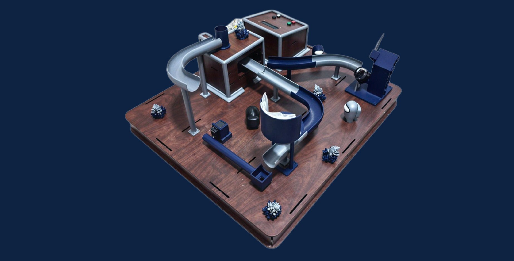
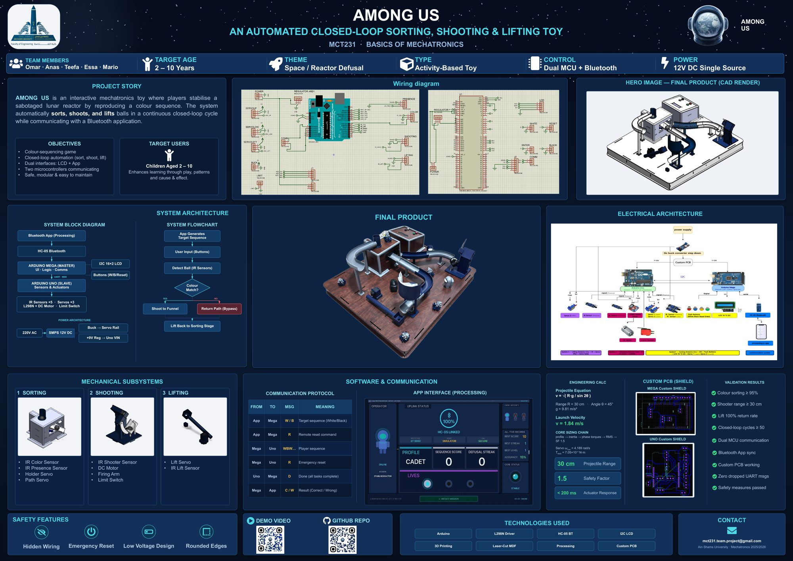

# AMONG US — Closed-Loop Sorting, Shooting & Lifting Toy


-006699?logo=processingfoundation&logoColor=white)


Final project for **MCT231 — Basics of Mechatronics**, Ain Shams University (I-CHEP), 2025/2026 · Team 9
Supervisor: Assoc. Prof. Dr. Shady A. Maged



An electromechanical game where the player "defuses a sabotaged lunar reactor" by entering a colour code. The machine then checks every ball physically: an IR sensor reads its colour, a servo routes it to a DC-motor shooter (match) or a return path (mismatch), and a servo lift carries it back to the start. The loop runs continuously with no manual reloading.

## System overview

| | |
|---|---|
| **Master MCU** | Arduino Mega: game state machine, I²C 16×2 LCD, 4 buttons, HC-05 Bluetooth link to the app |
| **Slave MCU** | Arduino Uno: 5 IR sensors, limit switch, 3 servos, DC shooter motor via L298N (PWM + direction) |
| **MCU link** | UART, 9600 baud (Mega `Serial1` ↔ Uno `SoftwareSerial` on A0/A1), short single-character commands |
| **App** | Processing (Android): generates the target sequence, 120 s countdown, lives, auto-fire mode for younger players |
| **Power** | Single 12 V SMPS → L298N (motor), buck converter (servo rail), 9 V regulator (Uno VIN) on two custom shield PCBs, common ground |
| **Mechanical** | Laser-cut MDF base, FDM 3D-printed tracks and funnels, modelled in SolidWorks |

### Communication protocol

| From → To | Message | Meaning |
|---|---|---|
| App → Mega | `W` / `B` … `\n` | Target colour sequence |
| Mega → Uno | `WBW…\n` | Player's submitted sequence |
| Uno → Mega | `S` | Ball is at the shooter, request fire code |
| Mega → Uno | `F` | Fire |
| Uno → Mega | `D` | Whole sequence physically processed |
| Mega → App | `C` / `W` | Result: correct / wrong |
| App → Mega → Uno | `R` | Emergency reset: stop motor, home all servos |
| App → Mega → Uno | `X` | Graceful exit: finish the current ball, park at the sorter |

### Safety and robustness

- Bluetooth failsafe: the Mega polls the HC-05 STATE pin and resets both boards if the link drops mid-round.
- Reset and exit commands are checked inside every blocking wait on the Uno, so the machine can be stopped mid-cycle.
- 6 s timeouts on the barrel and lift waits during an exit, so a stuck ball can't hang the loop.
- Shooter arm re-homes against a limit switch at boot and after every shot.
- Stale bytes on the inter-board link are flushed at the start of each round.

## Repository layout

```
Arduino_Code/   Arduino_Master_Mega.ino, Arduino_Slave_Uno.ino
App/            bomb.pde (Processing app)
Electrical/     Proteus projects for the Mega and Uno shield PCBs + wiring, system block diagram
Mechanical/     SolidWorks parts and assemblies (Project.SLDASM is the top level)
Docs/           Final report, A0 poster, presentation
```

## Poster



## Team

| Name | Role |
|---|---|
| Omar Mohamed Hegazy | Firmware + CAD design |
| Anas Mohamed Galal | CAD design |
| Abdelrahman Abdellateef | App, communication, code integration |
| Ahmed Essa Soliman | PCB, wiring diagrams, PDS, block diagram |
| Mario Ashraf Sami | Calculations + documentation |
